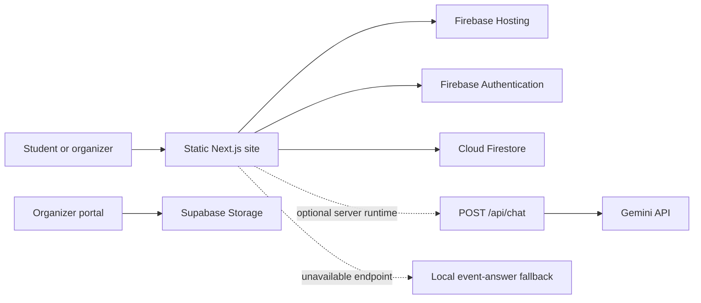

<div align="center">
  
  <br />
  <p><strong>A transition and leadership camp for the next horizon.</strong></p>
  <p>
    <a href="https://alathurpadidars.in/">Visit the event site</a>
    &nbsp;·&nbsp;
    <a href="https://alathurpadidars.in/admin">Organizer portal</a>
    &nbsp;·&nbsp;
    <a href="firebase.json">Firebase configuration</a>
  </p>
  <p>
    
    
    
    
    
  </p>
</div>

<br />

> **أُفُق — UFUQ ’26** is a seven-day transition and leadership camp organized by the Alathurpadi Dars Students Association (ADSA) for SUFFA Dars students preparing for higher studies. It connects a tradition of learning with the choices, confidence, and skills needed for what comes next.

<p align="center"><em>December 24–30, 2026 · Alathurpadi Dars Campus, Malappuram, Kerala</em></p>

<p align="center">
  <a href="#the-experience">The experience</a> &nbsp; / &nbsp;
  <a href="#get-started">Get started</a> &nbsp; / &nbsp;
  <a href="#configuration">Configuration</a> &nbsp; / &nbsp;
  <a href="#deployment">Deployment</a> &nbsp; / &nbsp;
  <a href="#project-map">Project map</a>
</p>

<br />

## A horizon for what comes next

UFUQ ’26 helps graduating students move from traditional Islamic learning into higher education and professional life with their knowledge, values, and sense of purpose intact. The site brings the camp’s story, practical details, and registration into one calm, multilingual experience.

<table>
  <tr>
    <td width="50%" valign="top">
      <h3>For students</h3>
      <ul>
        <li>Explore the camp, venue, dates, schedule, speakers, and FAQs.</li>
        <li>Read in English, Malayalam, or Arabic, including a right-to-left Arabic layout.</li>
        <li>Register, save the event to a calendar, and search camp information with <kbd>⌘</kbd>/<kbd>Ctrl</kbd> + <kbd>K</kbd>.</li>
        <li>Ask the UFUQ assistant about published camp details.</li>
      </ul>
    </td>
    <td width="50%" valign="top">
      <h3>For organizers</h3>
      <ul>
        <li>Manage event settings, schedule sessions, speakers, FAQs, and registrations.</li>
        <li>Review registration status, search records, and export a CSV.</li>
        <li>Manage the background audio playlist and upload media to Supabase Storage.</li>
        <li>Publish content through the Firebase-backed event data layer.</li>
      </ul>
    </td>
  </tr>
</table>

### The experience

| Discover | Plan | Take part |
| :--- | :--- | :--- |
| A story-led landing page introduces the camp and its organizers. | A seven-day schedule, guest profiles, location map, and FAQs help students prepare. | Registration includes field validation, a confirmation reference, and an event calendar download. |
| Search spans event information; the assistant answers common questions. | Light, dark, and system themes adapt to reader preference. | Ambient audio, install prompts, connection notices, and reduced-motion-aware transitions add polish without hiding the content. |

### Signature interactions

- **A live countdown** keeps the December 24 opening date in view; the event and individual sessions can be downloaded as calendar files.
- **A searchable event guide** finds schedule items, guests, and FAQs, with a `⌘K` / `Ctrl+K` shortcut.
- **A day-by-day schedule** can be filtered by day and session category.
- **An event assistant** answers camp questions from event records, with a local fallback when its server endpoint is unavailable.
- **A responsive soundscape player** offers playback controls, a playlist, and a live audio spectrum.
- **Organizer tools** include event settings, session and speaker editing, FAQ management, registration status, CSV export, and audio playlist management.

### Design language

| Design signature | Role in the experience |
| :--- | :--- |
| **Midnight navy** `#101D32` | Focus, clarity, and the night sky before a new horizon. |
| **Warm gold** `#C9A45C` | A precise accent drawn from the UFUQ identity. |
| **Quiet teal** `#527A70` | A grounded counterpoint for calm, readable emphasis. |
| **Clash Display · DG Sahabah · Arima** | English display typography, Arabic lettering, and Malayalam support. |

<details>
  <summary><strong>Accessibility and interaction notes</strong></summary>
  <br />

  The interface includes visible keyboard focus styles, labeled controls, responsive navigation, and a reduced-motion stylesheet. Motion is used for small transitions and supporting details; the page remains usable without it. Audio playback is user-controllable, and language selection updates the document language and direction.
</details>

## Built with care

| Layer | Tools |
| :--- | :--- |
| App | Next.js 15 App Router, React 19, TypeScript 5.7 |
| Styling & motion | Tailwind CSS 3, custom CSS transitions and animation |
| Data & identity | Firebase Authentication and Cloud Firestore |
| Media | Supabase Storage for uploaded speaker and audio media |
| Interaction | Lucide icons, browser Web Audio API |
| Delivery | Static export to Firebase Hosting; GitHub Actions workflow included |

### Architecture at a glance



The static site provides the public experience and browser-side Firebase connection. Supabase is only needed when organizers upload media. Gemini requests need a compatible server runtime; static Firebase Hosting uses the assistant’s local fallback.

## Get started

### You’ll need

- Node.js 20 or newer
- npm
- A Firebase project for shared content, authentication, and registrations
- A Supabase project only if organizers will upload media

### Run locally

```bash
git clone https://github.com/NavarMP/ufuq26.git
cd UFUQ26
npm ci
cp .env.example .env.local
npm run dev
```

Open [http://localhost:3000](http://localhost:3000). The project includes default event content, so the interface can be explored before connecting external services. Add your project values to `.env.local` to enable Firebase-backed data and organizer sign-in.

| Command | What it does |
| :--- | :--- |
| `npm run dev` | Starts the Next.js development server. |
| `npm run build` | Builds the application and static export in `out/`. |
| `npm run lint` | Runs the configured Next.js lint command. |

The `npm start` script runs `next start`, which is for a server deployment. This repository’s current production build is a static export, so serve `out/` with Firebase Hosting instead.

## Configuration

Copy `.env.example` to `.env.local`, then set the values for services you plan to use. Keep `.env.local` out of version control.

| Variable | Used by | Notes |
| :--- | :--- | :--- |
| `NEXT_PUBLIC_FIREBASE_API_KEY` | Firebase client | Public Firebase web-app configuration. |
| `NEXT_PUBLIC_FIREBASE_AUTH_DOMAIN` | Firebase client | Firebase Authentication domain. |
| `NEXT_PUBLIC_FIREBASE_PROJECT_ID` | Firebase client | Firebase project ID. |
| `NEXT_PUBLIC_FIREBASE_STORAGE_BUCKET` | Firebase client | Firebase Storage bucket name. |
| `NEXT_PUBLIC_FIREBASE_MESSAGING_SENDER_ID` | Firebase client | Firebase web-app sender ID. |
| `NEXT_PUBLIC_FIREBASE_APP_ID` | Firebase client | Firebase web-app ID. |
| `NEXT_PUBLIC_SUPABASE_URL` | Media uploads | Supabase project URL. |
| `NEXT_PUBLIC_SUPABASE_PUBLISHABLE_KEY` | Media uploads | Preferred browser-safe key; the legacy `NEXT_PUBLIC_SUPABASE_ANON_KEY` is also accepted. |
| `NEXT_PUBLIC_SUPABASE_STORAGE_BUCKET` | Media uploads | Optional; defaults to `ufuq-media`. Create a public bucket with this name. |
| `GEMINI_API_KEY` | Assistant on a server runtime | Optional key for Gemini responses from `/api/chat`. |
| `FIREBASE_ADMIN_PROJECT_ID` | Firebase Admin helper | Server-side only. Do not expose service credentials to a browser bundle. |
| `FIREBASE_ADMIN_CLIENT_EMAIL` | Firebase Admin helper | Server-side only. |
| `FIREBASE_ADMIN_PRIVATE_KEY` | Firebase Admin helper | Server-side only; preserve newline escaping as shown in `.env.example`. |
| `NEXT_PUBLIC_BASE_URL` | Optional base URL | Set the production origin when needed by custom integrations. |

Firebase client values currently have project defaults in `src/lib/firebase.ts`; setting the variables explicitly is recommended for a separate Firebase project. The Firebase Admin helper expects private credentials but is not used by the static public-site flow.

### Connect Firebase

1. Create a Firebase project and register a web app.
2. Enable **Email/Password** under Firebase Authentication and create organizer accounts.
3. Create a Cloud Firestore database.
4. Review and deploy the repository rules and indexes:

   ```bash
   firebase deploy --only firestore:rules,firestore:indexes
   ```

5. Add the Firebase web-app values to `.env.local` (or GitHub Actions secrets for a hosted build).

### Connect Supabase media uploads

1. Create a Supabase project and a public Storage bucket, default name `ufuq-media`.
2. Add the project URL and publishable key to `.env.local`.
3. Set the Storage Row-Level Security (RLS) policies so the admin portal can upload media. You can run the prepared script [supabase_storage_policies.sql](supabase_storage_policies.sql) in your **Supabase Dashboard > SQL Editor**, or create an `INSERT` policy for the `ufuq-media` bucket under **Storage > Policies**.

The repository’s Firebase Hosting and emulator settings live in [firebase.json](firebase.json), with Firestore access rules in [firestore.rules](firestore.rules) and the deployment workflow in [GitHub Actions](.github/workflows/firebase-deploy.yml).

## Deployment

The repository is configured with `output: 'export'` in `next.config.js`. A production build writes the static site to `out/`, which Firebase Hosting serves. The included GitHub Actions workflow builds and deploys on pushes to `main` or `master` after its Firebase secrets are configured.

```bash
npm run build
firebase deploy --only hosting
```

### Runtime behavior to know

The public Firebase Hosting configuration serves a static export. Next.js POST route handlers are not deployed as Firebase Hosting functions by this setup:

- The UFUQ assistant first tries `/api/chat`, then uses its local event-answer fallback if the endpoint is unavailable. Gemini replies require that route to run on a compatible server deployment with `GEMINI_API_KEY` set.
- The current registration form writes through the Firebase client SDK and also keeps a browser-local copy. Configure Firestore and its rules for organizer visibility across devices; browser-local records alone are not shared.
- `/api/register` exists in the source but is not used by the registration form.

If you need the Next.js API handlers in production, deploy a server-capable Next.js runtime or add and configure Firebase Functions. Do not place Firebase Admin credentials or Gemini keys in `NEXT_PUBLIC_*` variables.

<details>
  <summary><strong>Firebase Hosting with GitHub Actions</strong></summary>
  <br />

  The workflow lives at `.github/workflows/firebase-deploy.yml`. Configure the Firebase web-app settings, the Firebase service-account secret `FIREBASE_SERVICE_ACCOUNT_UFUQ_26`, and any Supabase or Gemini secrets required by your build. Then push to `main` or `master` to trigger the configured build and hosting deployment.
</details>

## Project map

```text
.
├── docs/
│   └── readme-cover.svg          # README artwork
├── public/
│   ├── fonts/                    # Clash Display and DG Sahabah fonts
│   ├── images/                   # UFUQ, ADSA, and event imagery
│   └── manifest.json             # Install metadata
├── src/
│   ├── app/                      # Routes, metadata, styles, and API handlers
│   ├── components/               # Landing page sections and interactions
│   ├── context/                  # App preferences, auth, audio, and event data
│   ├── lib/                      # Firebase, Supabase, translations, seed data
│   ├── locales/                 # English, Malayalam, Arabic dictionaries
│   └── types/                    # Shared TypeScript models
├── firestore.rules
├── firebase.json
├── storage.rules
├── firestore.indexes.json
└── package.json
```

The home page is assembled in `src/app/page.tsx`. Default event details and sample schedule, speaker, and FAQ content live in `src/lib/initialData.ts`; replace provisional entries with confirmed information before announcing them publicly.

## Content and operations

- Update published event details from the organizer portal at `/admin` after Firebase Authentication and Firestore are configured.
- Initial schedule and guest entries include sample placeholders. Confirm or replace them before treating them as final.
- The event content supports English, Malayalam, and Arabic. Public interface labels are maintained in `src/locales/`.
- Registration is intended for eligible SUFFA Dars students. The default event record lists December 10, 2026 as the deadline and a maximum of 100 participants; organizers should verify capacity and deadlines in the portal.
- Firebase and Supabase security rules are part of the application setup. Review them against your organization’s access policy before production use.

## Contributing

For a change proposal, include the user-facing outcome, relevant screenshots when the interface changes, and the services or environment values needed to reproduce it. Keep event details aligned across the localized dictionaries, default event data, and organizer-maintained content.

## License

No license file is currently included. Contact ADSA before reusing the project, event identity, or media outside this repository.

<br />

<p align="center">
  <strong>أُفُق ’26</strong><br />
  <sub>Rooted in Ilm. Ready for the World.</sub>
</p>
