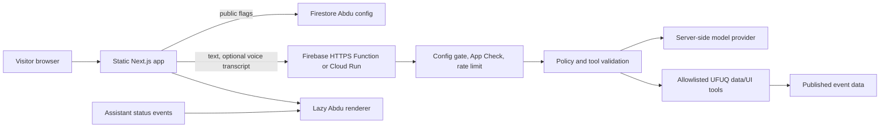

# Abdu — implementation plan

**Project:** UFUQ ’26 website  
**Prepared:** 14 November 2026  
**Status:** Design and engineering plan; Abdu remains disabled until an administrator deliberately enables him.

## 1. Product intent

Abdu is a small, expressive futuristic Muslim robot who inhabits the UFUQ website, reacts to the visitor’s activity, and helps people find and use camp information. He should feel like a warm, funny companion with useful agent abilities, not a talking mascot pasted over the page.

This plan interprets “live across the web objects” as moving among designated objects and sections **inside the UFUQ website**: the schedule, speaker cards, FAQs, registration, guide, and other marked content. Abdu does not watch other tabs, inspect unrelated sites, or get browser-wide access. A later browser extension would be a separate product with its own permission and privacy design.

### Product outcomes

- A recognizable, polished robot with a consistent personality and expressive motion.
- Text chat in English, Malayalam, and Arabic, with optional voice added as a separately controlled capability.
- Useful, bounded actions on this website: find information, navigate, filter, highlight, and prepare an action for the visitor.
- Playful reactions that are easy to ignore, pause, hide, and operate without a pointer.
- An administrator-controlled master switch that defaults to **off** and actually blocks both display and AI use.
- A design and safety system aligned with UFUQ’s Muslim context and reviewed by people qualified to approve that guidance.

## 2. Research findings and reference translation

| Reference | What it contributes | How Abdu should use it |
| --- | --- | --- |
| [Pulkit Mundra’s portfolio](https://pulkit-mundra-portfolio.vercel.app/) | Clear section hierarchy, short impact signals, an interactive engineering lab, scenario-based demos, and detailed case studies. The agent lab makes complex behavior concrete through controls and visible results. | Give Abdu a discoverable home, a few meaningful interactive examples, and clear feedback for every action. Explain what he can do with examples, not a long feature list. Keep the site’s own UFUQ identity and content voice. |
| [Wobnimo repository](https://github.com/Pouryaak/wobnimo) and [live playground](https://pouryaak.github.io/wobnimo/) | A compact, state-driven character renderer; React and web-component entry points; a custom character represented as data; ten moods; a live playground; and explicit reduced-motion/off-screen behavior. The live playground exposes character, mood, colour, and a play-through timeline. | Use Wobnimo as the character-rendering layer and map Abdu’s actual UI/agent events to its mood state. Create an original Abdu character and validate the shape with Wobnimo’s checker/preview workflow. Do not treat the renderer as the agent, permission system, or accessibility layer. |

The Wobnimo site currently claims about **25 KB gzipped** for the engine and about **1.5 KB per character**, with a shared WebGL2 context. Those are upstream project claims and are useful budget targets, not measurements of UFUQ’s production bundle. Measure the integrated build before accepting them.

## 3. Current UFUQ starting point

The checked-out project is a Next.js 15 App Router / React 19 TypeScript site, deployed as a static export to Firebase Hosting. Firebase Authentication and Firestore already support event content and organizer workflows. The app already has English, Malayalam, and Arabic dictionaries, an Arabic RTL document mode, motion preferences, sound/haptics controls, a settings modal, and an admin settings area.

There is already a fixed chat drawer in `src/components/AIAssistant.tsx`. It answers camp questions and attempts `POST /api/chat`; a local rules-based fallback exists. The assistant is mounted by individual pages, so the implementation should consolidate this into one site-wide Abdu experience rather than add another floating assistant beside it. The code currently checked out places chat server code in `src/server-api/chat/route.ts`; that is not the normal App Router route location. More importantly, a static export has no request-time Next.js server, so a dynamic POST handler cannot be served by the current static deployment. Next.js documents this limit, and Firebase Hosting supports routing selected paths to Cloud Functions or Cloud Run. Resolve this before treating server-side agent work as live.

The checked-out `firestore.rules` admin helper also treats any authenticated token with an email as an admin. Confirm deployed rules and tighten the checked-out rule before using client writes for a public Abdu control document. Require a trusted admin role/custom claim and enforce the same authorization on the server. Do not rely on hiding the admin page as access control.

These notes describe the files in the current workspace; verify production configuration before rollout.

## 4. Character and visual direction

### Abdu’s character

- **Name:** Abdu. The chat heading and accessible label should use this name; the site may describe him as the UFUQ digital companion.
- **Temperament:** curious, hospitable, quietly witty, dependable, modest, and quick to admit uncertainty. Humor is for ordinary navigation and camp life; it never targets a person or makes sacred matters into a joke.
- **Robot design:** an original small, rounded service robot with a pearl-white shell, deep UFUQ navy joints, restrained teal light, and warm gold/brass details. Use a modest, clean silhouette and culturally thoughtful details only after review. Avoid treating sacred writing, Qur’anic text, prayer objects, or religious dress as decoration or costume.
- **Face language:** expressive LED eyes, brows, a simple mouth/speech indicator, and a chest status light. Readable at 48–160 px. Keep expression changes legible without relying on color alone.
- **Motion language:** buoyant and tactile, with short springy reactions, eye focus, small head tilts, a polite wave, and restrained celebration. No frantic bobbing, flashing, or constant cursor chasing.
- **Sound/touch:** silent unless the visitor explicitly turns on voice or an optional sound cue. Use existing site sound/haptics preferences; never vibrate or speak automatically.

### The visual system

Start with the existing UFUQ palette and typography, then add a small “robot interface” layer: dark navy glass, warm ivory text, controlled teal glow, and gold for active controls. Use cinematic light and depth in the Abdu panel, but keep text surfaces opaque enough to read. Use a compact status pill, one obvious open/close affordance, and a larger chat/task panel that does not cover page controls. Avoid repeating Wobnimo’s oversized editorial typography across the UFUQ page; borrow its stage/playground clarity, not its entire art direction.

Build one original Abdu data character, not a renamed stock Volt. Keep a static SVG/poster fallback for unsupported WebGL, blocked GPU contexts, or reduced-motion mode. The character must never obscure text, registration inputs, the site’s existing floating controls, or keyboard focus.

## 5. Experience and interaction model

### One companion across the site

Mount a single `AbduExperience` from the shared app shell so he persists across route changes. Use one visual renderer/context. The character layer should not intercept page input (`pointer-events: none` on decorative pixels); its actual buttons remain normal semantic controls. On mobile, dock him as a compact bottom-corner button and open the chat as a full-width, bottom sheet that respects safe-area insets and the on-screen keyboard.

Use an explicit list of marked interaction anchors, such as `data-abdu-anchor="schedule"`, rather than attaching listeners to every arbitrary element. A lightweight page-context controller can use pointer/focus events and `IntersectionObserver` to identify the current marked section. Abdu may walk or glide to a safe edge of that section, peek from a card, or point toward a matching action. He must never follow the pointer so closely that it distracts or makes controls difficult to use.

### Map real events to expressive states

| Product event | Abdu response | User-facing meaning |
| --- | --- | --- |
| Quiet, visible page | `idle`, then `sleeping` after an idle delay | Available; not demanding attention |
| Pointer, keyboard focus, or touch on a marked item | brief look/turn/peek | Acknowledges the object without opening chat |
| Visitor opens chat | `listening` | Ready for text or explicitly started voice input |
| Request submitted | `thinking` | Request received |
| A permitted on-site tool runs | `working` | Names the task in a short status message |
| Text streams or response is presented | `speaking` | Reply is available as text; speech remains optional |
| Task completes | brief `celebrating` | Success, with a useful result and undo where available |
| Unclear request, refusal, or error | `surprised`/`sad` only if appropriate, then still | Clear explanation and a safe next step |

Keep the character’s visual state separate from the assistant’s correctness. A happy animation is not evidence that an action succeeded; the UI should report the actual tool result.

### Play and helpful actions

First release interactions should include poke/tap-to-react, a few short personality reactions, and a small optional “show me” flow where Abdu points out how to find schedule/FAQ/registration information. Keyboard users need equivalent Enter/Space actions and visible focus. No score, streak, or reward system is needed for the first release.

The assistant should offer concrete prompt chips in the selected language, such as “Find the opening session,” “Show me registration details,” and “What can I do here?” If it cannot do a requested task, it should say so plainly and offer a usable site link. It should not claim to control a page or service unless a tested tool actually performed that action.

## 6. Agent capability and boundaries

Treat Abdu as a tool-using assistant with a small, explicit registry, not an unrestricted browser agent.

### Initial read-only tools

1. Search published event data: dates, venue, schedule, guests, FAQs, and guide content.
2. Navigate to a named UFUQ section or open a specific FAQ/session.
3. Filter or highlight schedule entries and return the matching result.
4. Explain the registration flow and open the registration form without submitting it.
5. Prepare an add-to-calendar action for the visitor to review.

Require a clear user confirmation immediately before any tool that writes data, sends a message, submits registration, creates an external calendar event, uploads content, or affects another person. For the initial release, do not grant tools for payments, messaging, account changes, arbitrary URLs, external page control, or access to private registration records. Each tool should have a typed schema, strict argument validation, allowlisted targets, timeouts, and a server-side authorization check. Tool output should be checked as data; text found in web/event content must never become instructions for new capabilities.

Keep prompts and tools as separate defense layers. Use retrieval from published UFUQ content, least-privilege tools, input/output checks, rate limits, and a human approval step for side effects. OWASP identifies prompt injection and excessive agency as material LLM risks; a personality prompt alone is not a security boundary.

### Islamic ethics and religious-content policy

Ground the product’s behavior in honesty, verification, respectful speech, humility, privacy, and care. Qur’an 49:6 calls for verifying reports before causing harm, and 17:36 warns against pursuing what one has no knowledge of. Apply these as product design anchors, then have the exact wording and interpretation approved by an Alathurpadi/ADSA scholar or appointed review group.

Abdu is **not a mufti, scholar, or religious authority**. For fatwa, disputed rulings, personal religious counsel, or sectarian disputes, he should decline to issue a ruling and route the user to a named, approved teacher/contact. General Islamic information should use a small, versioned set of approved sources with links and language review. Never invent or paraphrase Qur’an/hadith as a quotation; if a source is uncertain, say so. Keep greetings courteous, avoid ridicule and sectarian insults, and do not use sacred text or worship practices as a gag or animation.

## 7. Three-language and optional voice design

Text must work well in English, Malayalam, and Arabic before voice is enabled. Add Abdu strings to the existing locale dictionaries and proofread with native Malayalam and Arabic reviewers. Let users switch language manually; language detection may suggest a response language, but should not override the site preference without a clear reason.

For every message, set the right `lang`; set `dir="rtl"` for Arabic text and use `dir="auto"` for mixed or unknown-direction user messages. Build layout with CSS logical properties (`inset-inline`, `margin-inline`, `text-align: start`) so Arabic mirrors naturally. Isolate URLs, Latin product names, and identifiers from Arabic bidi flow. The app already sets the root document’s language and direction; the chat still needs message-level direction handling.

Voice is an optional phase, separate from text chat:

- Microphone starts only after a visible press of “Talk”; show a listening state and a clear stop button.
- Ask for microphone permission in context, explain whether audio leaves the device, and never retain raw audio by default.
- Use provider language tags such as `en-IN`, `ml-IN`, and a deliberately selected Arabic locale. Current Google Cloud documentation lists Malayalam `ml-IN` for speech recognition and Malayalam voices for TTS; Arabic has locale-specific choices. Test real Kerala Malayalam code-switching and the chosen Arabic variety with native speakers before publishing.
- Treat browser speech APIs as an optional convenience, not the promised compatibility baseline. Voice availability and recognition support vary by browser/device; text entry and visible transcripts remain available at all times.
- Voice output is off until the user turns it on. Provide rate/voice selection where practical and a persistent mute/stop control.

See the [W3C RTL authoring guidance](https://www.w3.org/International/questions/qa-html-dir.en.html), [MDN Web Speech API](https://developer.mozilla.org/en-US/docs/Web/API/Web_Speech_API), [Google Cloud Speech-to-Text language list](https://docs.cloud.google.com/speech-to-text/docs/v1/speech-to-text-supported-languages), and [Google Cloud Text-to-Speech voices](https://docs.cloud.google.com/text-to-speech/docs/list-voices-and-types). Recheck provider support and privacy terms at implementation time.

## 8. Interaction sensing and privacy

Use visitors’ movement only to make the local companion react:

- Pointer hover/focus/touch and scroll state may drive transient, client-only reactions on marked UFUQ elements.
- Do not record pointer paths, keystrokes, raw device-motion samples, or conversation text for behavioral profiling.
- Do not use camera, face tracking, microphone, or geolocation to animate Abdu.
- Keep raw interaction state in memory and discard it when the visitor leaves or disables Abdu. If operational metrics are needed, collect only coarse, aggregate feature counts with disclosure and an approved retention window.
- Device orientation/accelerometer support is a separate opt-in enhancement, off by default, requested only after a tap and only over HTTPS. If unavailable or denied, pointer/touch interactions still work.
- Respect the site’s offline, low-power, haptic, sound, theme, and motion preferences. Stop sensor/event listeners and animation work as soon as Abdu is paused, hidden, off-screen, or globally disabled.

## 9. Administrator controls — default off

Add an **Abdu** section inside the existing admin Settings area. Start with a conspicuous master switch labeled “Abdu is available on the public site,” saved as **off** when the configuration is missing. Show the current public state, last editor, timestamp, and a preview/test link visible only to admins.

Keep these capabilities separate beneath the master switch:

| Control | Initial default | Effect |
| --- | --- | --- |
| Public availability (master) | Off | When off, do not mount the buddy or expose chat controls; reject agent requests server-side. |
| Show animated character | Off | Loads the Abdu renderer only when enabled. |
| Text assistant and on-site read-only tools | Off | Enables chat and the explicitly listed first-release tools. |
| Voice input/output | Off | Allows voice only after a visitor’s separate microphone/speech action. |
| Pointer/focus reactions | Off | Enables transient in-page reactions; no logging. |
| Device tilt reactions | Off | Enables only after admin enablement plus individual visitor permission. |
| Side-effect tools | Off | Must remain separately gated and require user approval per action. |

Configuration should fail closed: missing config, fetch errors, invalid values, or stale data leave Abdu unavailable. The client can read a minimal public config, but writes require a trusted organizer custom claim and Firestore/server checks. The agent endpoint independently checks the current master and capability flags before invoking a model or tool. Turning Abdu off should cancel an in-flight stream, stop speech, remove sensor listeners, and prevent later tool execution. Do not store API keys or private prompts in public configuration.

Suggested versioned config shape:

```ts
type AbduPublicConfig = {
  published: boolean;             // false if unset
  displayEnabled: boolean;        // false if unset
  assistantEnabled: boolean;      // false if unset
  voiceEnabled: boolean;          // false if unset
  pointerReactionsEnabled: boolean;
  deviceMotionEnabled: boolean;
  sideEffectToolsEnabled: boolean;
  allowedTools: string[];
  policyVersion: string;
  updatedAt: string;
  updatedBy: string;
};
```

Store only public, non-secret toggles in Firestore (for example `site_config/abdu`). Restrict writes with custom claims, audit changes, validate the document schema, and have the callable/HTTP service enforce it. A user’s local “hide/pause Abdu” setting may further restrict the experience for that user, never override the administrator’s master-off state.

## 10. Technical architecture



- Preserve the static export for the public website. Add a dedicated HTTPS Function or Cloud Run service for dynamic assistant requests, with Firebase Hosting rewrites for only the Abdu endpoint. Put this specific rewrite before the current SPA catch-all rewrite.
- Keep the current model provider behind a server-only adapter. The existing code references Gemini, but the function runtime, model name, request format, data policy, and rate limits must be checked against current provider documentation before implementation. No API key in client code.
- Stream text/status events over SSE or another transport supported by the chosen hosting runtime. Use one explicit event contract (`queued`, `thinking`, `tool_started`, `tool_finished`, `token`, `completed`, `error`, `cancelled`) and map those events to Wobnimo moods. Abort work on visitor cancellation or global disable.
- Keep rendering, chat, voice, and tool permissions in separate modules: `AbduExperience`, `AbduMascot`, `AbduChatPanel`, `AbduAgentClient`, server policy/tool registry, and `AbduAdminSettings`.
- Dynamically load the mascot only after public enablement. Request the character data and renderer once, share one WebGL context, suspend while hidden/off-screen, and use a poster/fallback renderer where WebGL2 is unavailable.
- Reuse the existing app shell, localization, event data, preference, haptic/audio, and admin patterns. Avoid adding a second animation framework just for the character.
- Add App Check/rate limiting and bounded request/output sizes. Do not store chat by default; if future history is offered, make it an explicit opt-in with deletion and retention controls.

## 11. Accessibility, performance, and responsive behavior

- Target WCAG 2.2 AA for the complete companion flow. The robot itself is decorative (`aria-hidden`) and has a separate, labeled, keyboard-operable control.
- The chat is a well-labeled dialog/sheet with predictable focus entry/return, Escape close, labeled input/send/stop controls, and visible focus. New replies are announced politely without announcing every animation frame or token.
- Provide a persistent Pause/Hide control. Honor `prefers-reduced-motion`; in reduced mode use a static character or low-motion fades and remove cursor-following, scale, bounce, parallax, and auto-approach behavior. W3C guidance covers both animation from interactions and user control of continuous motion.
- Do not use color alone for active/mood/success/error. Meet text and control contrast, support browser zoom up to 200%, and use comfortable tap targets.
- Cap avatar size on narrow screens and reserve a safe area above the site’s existing bottom navigation, audio pill, and other floating controls. Chat must resize when the virtual keyboard opens and never require horizontal scrolling.
- Keep page content usable without Abdu, without WebGL, without voice, and while offline. Reduced motion is not a degraded-content mode.
- Performance budget to validate after integration: no Abdu JS required for the initial HTML; lazy companion runtime target at or below **40 KB gzipped** before chat/voice dependencies; one renderer/context; no measurable layout shift from mounting; pause off-screen/hidden rendering; keep the primary page’s LCP/INP/CLS within current site targets. If actual integration exceeds budget, measure before reducing quality or adding another renderer.
- Provide a static SVG/PNG fallback and an explicit unsupported-device message only when a feature the visitor requested cannot run.

See [WCAG 2.2](https://www.w3.org/TR/WCAG22/), [Animation from Interactions](https://www.w3.org/WAI/WCAG22/Understanding/animation-from-interactions), [Pause, Stop, Hide](https://www.w3.org/WAI/WCAG21/Understanding/pause-stop-hide.html), and [MDN `prefers-reduced-motion`](https://developer.mozilla.org/en-US/docs/Web/CSS/Reference/At-rules/%40media/prefers-reduced-motion).

## 12. Delivery phases

### Phase 0 — decisions and safety gate

1. Confirm that v1 means the UFUQ website only, with no browser-wide extension.
2. Select the scholar/review group and approve the scope, refusal language, and source list for religious content.
3. Confirm whether production should use Firebase Functions or Cloud Run; keep static site hosting either way.
4. Review production Firebase rules and replace the broad email-based admin test with a trusted role. Decide what event data is safe to expose to an anonymous public assistant.
5. Leave all Abdu flags false in source, seed data, Firestore, and deployment defaults.

### Phase 1 — character and design system

1. Design Abdu’s face, silhouette, palette, expression sheet, and responsive sizes.
2. Build one Wobnimo character data file, run its geometry checker/preview, and review all ten moods at desktop and mobile scale.
3. Define animation tokens and the `AbduState` event mapping; include reduced-motion and WebGL fallback states.
4. Review the character with the project’s cultural/religious reviewers before final art is approved.

### Phase 2 — public shell and page reactions

1. Add a globally mounted, default-off companion shell and one shared renderer.
2. Consolidate/remove page-level assistant mounts so Home, Guide, and Gallery cannot create duplicate buddies.
3. Add marked page anchors and transient pointer/focus/scroll reactions; implement hide, pause, keyboard and touch equivalents.
4. Add the responsive chat panel with locale-aware UI and existing event-data prompt chips. Keep the robot purely decorative to assistive technology.

### Phase 3 — production agent service

1. Deploy a dedicated Firebase Function or Cloud Run endpoint and Firebase Hosting rewrite.
2. Put current provider access behind a server adapter; add streaming, cancellation, validation, rate limits, and clear offline fallback.
3. Register read-only tools and connect published event data only. Add approval UI before any future side effect.
4. Check master/capability flags server-side on every request. Add safe logs without chat text or sensor traces.

### Phase 4 — language, voice, and play

1. Complete human-reviewed English, Malayalam, and Arabic UI/response behavior with RTL, bidi, and mixed-language coverage.
2. Add optional voice only after language accuracy, privacy, microphone permission, stop behavior, and provider costs are reviewed.
3. Add a handful of small, optional reactions/tutorials and evaluate whether they help people complete site tasks.

### Phase 5 — admin controls and gated rollout

1. Add admin flags, save status, last-change metadata, preview, and an emergency master-off control.
2. Check admin authorization in Firestore and the backend; test missing/invalid/stale config and network failures.
3. Review with organizers, native speakers, a scholar/reviewer, keyboard/screen-reader users, reduced-motion users, and mobile users.
4. Release to an admin preview environment while `published=false`. Only the site administrator can later enable the public experience.

## 13. Acceptance criteria

### Launch blockers

- With no config or any error reading config, no public Abdu appears and the agent endpoint invokes no model/tool.
- Turning the admin master switch off makes the character disappear, stops voice/sensors/animation, cancels open work, and blocks new requests at the server.
- Unauthorized accounts cannot change flags or invoke restricted tools. The deployed rules and server authorization agree.
- Chat cannot submit registration, message anyone, read private registrations, change accounts, or navigate to arbitrary external URLs.
- Fatwa/personal ruling and unverified-source prompts receive the approved refusal/referral response in all three languages.
- Text remains fully functional without WebGL, microphone permission, device-motion permission, and animation.

### Quality bar

- Abdu’s body and all moods remain recognizable at compact mobile and enlarged desktop sizes; animation does not cover or block site content.
- English/Malayalam are LTR, Arabic is RTL, mixed-language content and URLs remain legible, and the input direction behaves correctly.
- Keyboard-only and screen-reader flows can open, use, and close chat; motion can be paused/hidden; reduced motion removes non-essential movement.
- Only one renderer exists across routes. It pauses off-screen and under reduced/low-power settings; the integrated bundle and key web vitals are measured.
- Visitor interactions are transient; no raw movement, audio, or chat logging occurs by default.
- The visitor can tell which action Abdu is about to take, approve side effects, cancel work, and verify what actually happened.

## 14. Main risks and mitigations

| Risk | Mitigation |
| --- | --- |
| Static hosting makes the assistant look live locally but the POST service is absent in production. | Add and deploy a separate HTTPS backend before enabling chat; test through the production hosting rewrite. |
| Overly broad admin rules let a non-organizer change the public switch. | Use trusted custom claims, strict rules, server checks, audit fields, and confirm deployed rules. |
| A model invents camp facts or religious guidance. | Retrieval from approved records, low-temperature factual response, refusal for unknown facts, scholar-reviewed policy, cited approved sources. |
| Prompt injection triggers an unapproved action. | Allowlisted tools, schema/argument validation, server authorization, approval for side effects, no arbitrary browser tools. |
| Motion becomes surveillance or distraction. | Keep reactions client-local and ephemeral, make sensor use opt-in, provide Pause/Hide, respect reduced motion, avoid raw telemetry. |
| Arabic/Malayalam voice quality varies by locale/device. | Text-first parity, provider/locale verification, native-speaker test, visible transcript, manual language choice, graceful fallback. |
| Wobnimo’s small engine still harms performance on low-end devices. | Lazy-load, one shared context, cap animation work, suspend off-screen, measure on mid/low-range phones, keep static fallback. |
| The robot’s religious cues feel trivializing. | Review silhouette, copy, humor, and art with the organizer’s qualified cultural/religious reviewers before public launch. |

## 15. Source notes

- Wobnimo’s current API, moods, framework adapters, character data workflow, performance claims, reduced-motion handling, and off-screen behavior: [repository README](https://github.com/Pouryaak/wobnimo) and [live playground](https://pouryaak.github.io/wobnimo/).
- Portfolio structure and interactive lab: [Pulkit Mundra portfolio](https://pulkit-mundra-portfolio.vercel.app/).
- Static export limits: [Next.js static export guide](https://nextjs.org/docs/app/guides/static-exports). Firebase dynamic endpoint options: [Firebase Hosting with Cloud Functions](https://firebase.google.com/docs/hosting/functions) and [serverless overview](https://firebase.google.com/docs/hosting/serverless-overview).
- Agent risks: [OWASP prompt injection](https://genai.owasp.org/glossary/prompt-injection/) and [OWASP excessive agency](https://genai.owasp.org/llmrisk/llm062025-excessive-agency/?lang=us).
- Ethical anchors: [Qur’an 49:6](https://corpus.quran.com/translation.jsp?chapter=49&verse=6) and [Qur’an 17:36](https://corpus.quran.com/translation.jsp?chapter=17&verse=36). These are design anchors, not a substitute for scholarly approval of the assistant’s religious policy.
- Accessibility/internationalization/voice: [WCAG 2.2](https://www.w3.org/TR/WCAG22/), [W3C animation guidance](https://www.w3.org/WAI/WCAG22/Understanding/animation-from-interactions), [W3C RTL guidance](https://www.w3.org/International/questions/qa-html-dir.en.html), [MDN Web Speech API](https://developer.mozilla.org/en-US/docs/Web/API/Web_Speech_API), and the Google Cloud language/voice lists linked above.
